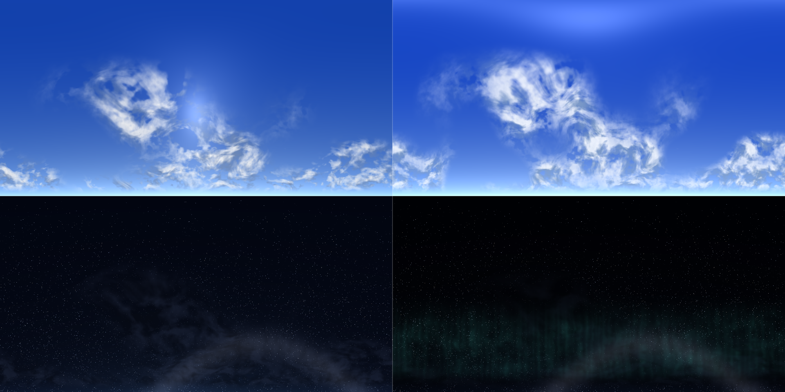

# Skyweaver

Data-driven custom skies for **Minecraft 26.1** and **NeoForge 26.1.0.19-beta**.

Skyweaver replaces the overworld sky with a resource-pack-defined skybox: six time-of-day
panoramas (day, noon, sunrise, sunset, night, midnight) and moving sun and moon discs. The
included **Skyweaver 4K Skies** pack adds realistic procedural 4K artwork with a clean,
unobstructed horizon.



## Download

- [Latest GitHub release](https://github.com/jumayusiii/skyweaver/releases/latest)

## The 24-hour circle

Day, noon, night and midnight are the four headline looks. They form one continuous 24-hour
circle, with sunrise and sunset bridging the light changes:

| Normalized time | Sky |
| --- | --- |
| `0.00` | noon |
| `0.16`–`0.22` | day |
| `0.25` | sunset |
| `0.33`–`0.44` | night |
| `0.44`–`0.56` | midnight |
| `0.56`–`0.67` | night |
| `0.73`–`0.80` | sunrise |
| `0.86`–`0.94` | day |
| `1.00` | noon, wrapping seamlessly back to `0.00` |

Every boundary is a smoothstep crossfade driven by the game's `sun_angle`, so the cycle follows
the dimension's own timeline and never snaps. The horizon stays clean and unobstructed throughout.

## Why it is lightweight and compatible

- **No mixins, no coremods, no patched vanilla classes.** Skyweaver uses NeoForge's official
  `CustomSkyboxRenderer` hook plus `ExtractLevelRenderStateEvent` and `RegisterRenderPipelinesEvent`.
- **Sodium / Lithium:** both replace terrain or server-side logic. Skyweaver only draws in the sky
  pass, so terrain optimisations are untouched.
- **Iris shader packs:** detected through Iris's public API by reflection. While a shader pack is
  active Skyweaver steps aside and lets the pack draw the sky (`respect_shader_packs = true`).
- **OptiFine:** OptiFine does not exist for NeoForge 26.1. Skyweaver does not install OptiFine
  custom-sky files or require OptiFine; use the mod's own pack format. No OptiFine code is loaded.
- **Other sky mods / datapacks:** if a custom skybox is already selected for the dimension,
  Skyweaver leaves it alone.

## Requirements

| Component | Version |
| --- | --- |
| Minecraft | 26.1 |
| NeoForge | 26.1.0.19-beta or newer 26.1 build |
| Java | 25 |

## Installation

1. Put `skyweaver-1.2.0.jar` in the instance's `mods/` folder.
2. Put `Skyweaver-4K-Skies.zip` in `resourcepacks/` and enable it in **Options → Resource Packs**.
   The pack must be above the mod's built-in resources, which is the normal resource-pack order.
3. Launch the world. The pack is client-side only.

Without the 4K pack the mod still works, using its bundled 1024 px fallback versions of the same
skies. The pack simply overrides those textures at higher resolution and costs no extra mod code.

Outputs:

- Mod: `build/libs/skyweaver-1.2.0.jar`
- Pack folder: `resourcepack/`
- Pack zip: `dist/Skyweaver-4K-Skies.zip`

## Compatibility tested

The published 1.1.1 build was verified on a clean NeoForge 26.1.0.19-beta / Minecraft 26.1 client
with Sodium **0.8.9+mc26.1.1**, Lithium **0.24.7+mc26.1.2**, Iris **1.10.9+mc26.1.1** and BSL
Shaders **10.1.8**. All four loaded together with Skyweaver and the 4K pack; with shaders off
Skyweaver rendered, and with BSL active Iris owned the sky and Skyweaver stepped aside.

The 1.2.0 build was launched with the 4K pack at noon, day, sunset and midnight with no `ERROR`
or `FATAL` entries. The 1.2.0 changes are new textures and a new optional noon texture key; they
do not change the render pipeline. Iris 1.11.4 paired with Sodium 0.8.9 currently fails during
Sodium mixin application with a missing `uniformBufferManager` field; use a matching pair.

## The Skyweaver 4K Skies pack

| Texture | Resolution |
| --- | --- |
| `day.png` / `noon.png` / `sunrise.png` / `sunset.png` / `night.png` / `midnight.png` | 4096 × 2048 zenith-to-horizon |
| `sun.png` / `moon.png` | 512 × 512 RGBA |

Everything is generated from periodic 3D value/gradient noise by
[`tools/SkyTextureGen.java`](tools/SkyTextureGen.java) — no stock imagery. Run it with Java 25:

```bash
java tools/SkyTextureGen.java            # 4K pack + previews
java tools/SkyTextureGen.java --fallback # 1024 px textures used inside the mod jar
```

The 4K PNGs are intentionally compact because they are smooth gradients rather than photographic
noise. GPU memory is the real cost: roughly 192 MiB of RGBA when all six skies are resident.

## Skybox pack format

A resource pack adds `assets/<namespace>/skyboxes/<path>.json` and references it with
`skybox = "<namespace>:<path>"` in `config/skyweaver-client.toml`.

```json
{
  "dimensions": ["minecraft:overworld"],
  "textures": {
    "day": "mypack:textures/sky/day.png",
    "noon": "mypack:textures/sky/noon.png",
    "sunrise": "mypack:textures/sky/sunrise.png",
    "sunset": "mypack:textures/sky/sunset.png",
    "night": "mypack:textures/sky/night.png",
    "midnight": "mypack:textures/sky/midnight.png"
  },
  "sun": "mypack:textures/sky/sun.png",
  "moon": "mypack:textures/sky/moon.png",
  "sun_scale": 30.0,
  "moon_scale": 20.0
}
```

- **textures** (required): four opaque zenith-to-horizon panoramas (`day`, `sunset`, `night`,
  `midnight`) plus optional `noon` and `sunrise` panoramas. Image top is the zenith and the bottom
  edge is the horizon. A pack without `noon` reuses `day`; a pack without `sunrise` reuses `sunset`.
- **dimensions** (optional): dimensions that use this sky. Defaults to `minecraft:overworld`.
  Only dimensions with a visible skybox can render it.
- **sun / moon** (optional): RGBA discs. Omit either to skip that disc. They are positioned by the
  game's sun/moon angles, including their normal day cycle.
- **sun_scale / moon_scale** (optional): quad size, defaults 30 and 20.

Any number of skyboxes can live in a pack; select the active one with the `skybox` config option.
For example a snow or alien dimension can ship its own definition without touching the mod.

## Configuration

`config/skyweaver-client.toml`:

| Option | Default | Meaning |
| --- | --- | --- |
| `enabled` | `true` | Disable to use the vanilla sky. |
| `skybox` | `"skyweaver:default"` | Active definition, `namespace:path`. |
| `respect_shader_packs` | `true` | Yield to Iris shader packs while one is active. |

The same options are available from the in-game mod config screen.

## Building

```bash
./gradlew build
```

Requires Java 25 (the toolchain is pinned in `build.gradle`). The resource pack can be rebuilt with
the generator command above, then zipped from `resourcepack/` with `pack.mcmeta` at the archive root.

## Notes and limits

- The current implementation targets the **Overworld**; add other dimensions to `dimensions` if
  their skybox should be replaced too. The Nether has no skybox and is therefore never replaced.
- Weather darkens the sky and fades the sun/moon, but rain particles and clouds remain vanilla.
- Moon phases use one full-moon texture; the pack does not ship eight phase variants.
- Shader packs intentionally override Skyweaver while active. Disable the shader pack (or set
  `respect_shader_packs = false`) to compare.

## License

MIT. The procedural textures and preview images are generated by this repository and are covered by
the same license. `TEMPLATE_LICENSE.txt` covers the NeoForge MDK scaffolding only.
